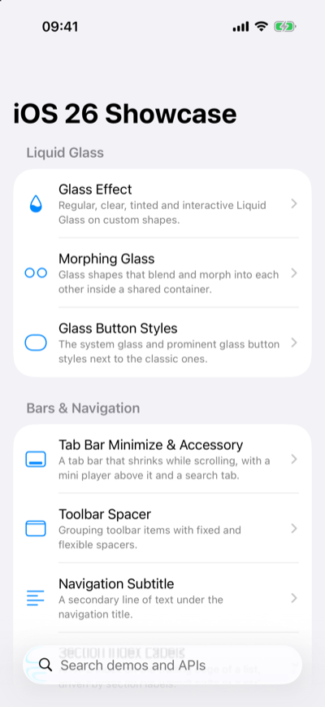
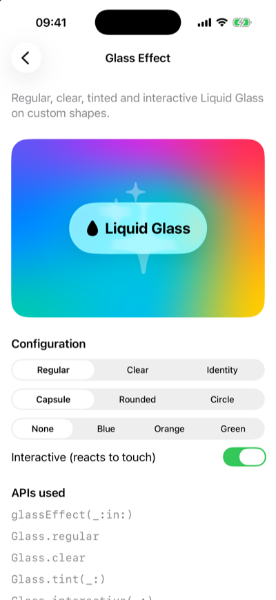
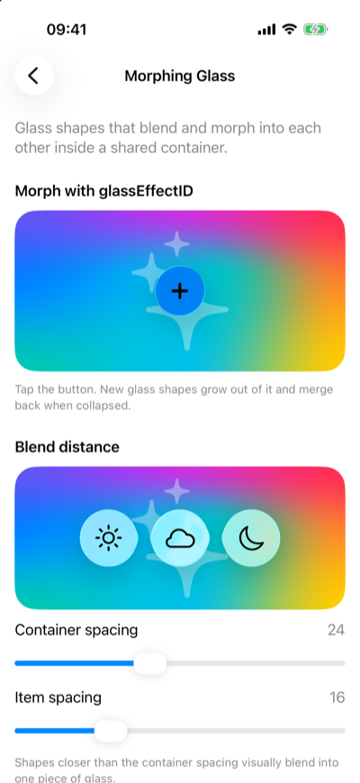
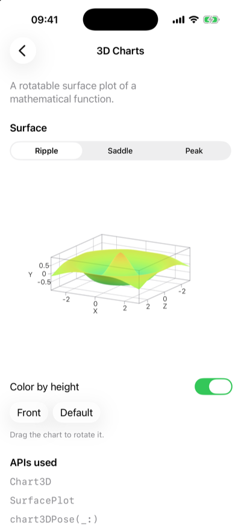

<!-- brand:start -->

<p align="center"><picture><source media="(prefers-color-scheme: dark)" srcset="https://raw.githubusercontent.com/muhittincamdali/SwiftUI-iOS26-Showcase/main/.github/brand/banner-dark.svg"><source media="(prefers-color-scheme: light)" srcset="https://raw.githubusercontent.com/muhittincamdali/SwiftUI-iOS26-Showcase/main/.github/brand/banner-light.svg"></picture></p>

<!-- lang-selector:start -->
<p align="center"><a href="README.md">English</a> · <a href="README.tr.md">Türkçe</a> · <a href="README.zh-CN.md">简体中文</a> · <a href="README.ja.md">日本語</a> · <a href="README.ko.md">한국어</a> · <a href="README.es.md">Español</a> · <a href="README.de.md">Deutsch</a> · <a href="README.fr.md">Français</a> · <a href="README.pt-BR.md">Português (Brasil)</a> · <a href="README.ru.md">Русский</a></p>
<!-- lang-selector:end -->

<p align="center">
<a href="https://github.com/muhittincamdali/SwiftUI-iOS26-Showcase/actions/workflows/ci.yml"></a>
<a href="https://github.com/muhittincamdali/SwiftUI-iOS26-Showcase/releases"><picture><source media="(prefers-color-scheme: dark)" srcset="https://raw.githubusercontent.com/muhittincamdali/SwiftUI-iOS26-Showcase/main/.github/brand/badge-version-dark.svg"><source media="(prefers-color-scheme: light)" srcset="https://raw.githubusercontent.com/muhittincamdali/SwiftUI-iOS26-Showcase/main/.github/brand/badge-version-light.svg"></picture></a>
<a href="https://github.com/muhittincamdali/SwiftUI-iOS26-Showcase/blob/main/Package.swift"><picture><source media="(prefers-color-scheme: dark)" srcset="https://raw.githubusercontent.com/muhittincamdali/SwiftUI-iOS26-Showcase/main/.github/brand/badge-platforms-dark.svg"><source media="(prefers-color-scheme: light)" srcset="https://raw.githubusercontent.com/muhittincamdali/SwiftUI-iOS26-Showcase/main/.github/brand/badge-platforms-light.svg"></picture></a>
<a href="https://github.com/muhittincamdali/SwiftUI-iOS26-Showcase/blob/main/Package.swift"><picture><source media="(prefers-color-scheme: dark)" srcset="https://raw.githubusercontent.com/muhittincamdali/SwiftUI-iOS26-Showcase/main/.github/brand/badge-language-dark.svg"><source media="(prefers-color-scheme: light)" srcset="https://raw.githubusercontent.com/muhittincamdali/SwiftUI-iOS26-Showcase/main/.github/brand/badge-language-light.svg"></picture></a>
<a href="https://github.com/muhittincamdali/SwiftUI-iOS26-Showcase/blob/main/LICENSE"><picture><source media="(prefers-color-scheme: dark)" srcset="https://raw.githubusercontent.com/muhittincamdali/SwiftUI-iOS26-Showcase/main/.github/brand/badge-license-dark.svg"><source media="(prefers-color-scheme: light)" srcset="https://raw.githubusercontent.com/muhittincamdali/SwiftUI-iOS26-Showcase/main/.github/brand/badge-license-light.svg"></picture></a>
</p>

<p align="center">
<a href="#quick-start"><picture><source media="(prefers-color-scheme: dark)" srcset="https://raw.githubusercontent.com/muhittincamdali/SwiftUI-iOS26-Showcase/main/.github/brand/button-start-en-dark.svg"><source media="(prefers-color-scheme: light)" srcset="https://raw.githubusercontent.com/muhittincamdali/SwiftUI-iOS26-Showcase/main/.github/brand/button-start-en-light.svg"></picture></a>
<a href="https://muhittincamdali.github.io/SwiftUI-iOS26-Showcase/documentation/swiftuiios26showcase/"><picture><source media="(prefers-color-scheme: dark)" srcset="https://raw.githubusercontent.com/muhittincamdali/SwiftUI-iOS26-Showcase/main/.github/brand/button-docs-en-dark.svg"><source media="(prefers-color-scheme: light)" srcset="https://raw.githubusercontent.com/muhittincamdali/SwiftUI-iOS26-Showcase/main/.github/brand/button-docs-en-light.svg"></picture></a>
<a href="https://github.com/muhittincamdali/SwiftUI-iOS26-Showcase/tree/main/Examples"><picture><source media="(prefers-color-scheme: dark)" srcset="https://raw.githubusercontent.com/muhittincamdali/SwiftUI-iOS26-Showcase/main/.github/brand/button-examples-en-dark.svg"><source media="(prefers-color-scheme: light)" srcset="https://raw.githubusercontent.com/muhittincamdali/SwiftUI-iOS26-Showcase/main/.github/brand/button-examples-en-light.svg"></picture></a>
</p>

<!-- brand:end -->

SwiftUI iOS 26 Showcase is a Swift package with sixteen small SwiftUI screens, each built around
one group of APIs that are new in iOS 26 and macOS 26: Liquid Glass, the new bar and scroll
modifiers, rich text editing, the native web view, 3D charts, SF Symbol draw effects, the
`@Animatable` macro and the on-device Foundation Models framework. Every screen has controls to
try the API's options and lists the SDK symbols it uses. It is for developers who want to see
these APIs working before they use them: run the whole gallery, or drop a single screen into
your own app.

## Highlights

- **16 demos in 6 categories**: Liquid Glass, bars and navigation, scrolling and layout, text
  and web, charts and symbols, and Apple Intelligence. 14 of them also run on macOS.
- **Searchable gallery**: `ShowcaseGallery` lists the demos available on the current platform,
  and search matches titles, summaries and API names.
- **One screen at a time**: `ShowcaseDemoView(.chart3D)` puts a single demo into your own
  navigation.
- **Tested on macOS and in the iOS Simulator**: Swift Testing suites check the catalog, the
  helper types and that the demo table below matches the code. A rendering test checks that
  each demo draws more than its summary and API list, as far as `ImageRenderer` can draw it: the
  two `List`-based demos are skipped, and in the web view demo the test sees the address and
  status bars but not the `WebView`.
- **Example app**: an iOS and macOS app in [Examples/ShowcaseApp](Examples/ShowcaseApp) that
  can open any demo from a launch argument.

## Quick start

**1. Add the package**

In Xcode, choose **File › Add Package Dependencies…** and enter the repository URL:

```text
https://github.com/muhittincamdali/SwiftUI-iOS26-Showcase.git
```

In the same dialog, set **Dependency Rule** to **Branch** and type `main` (the 1.0.0 release
predates these demos). Click **Add Package**, choose your app target in the **Add to Target**
column, and click **Add Package** again.

**2. Import the module**

```swift
import SwiftUIiOS26Showcase
```

**3. Use it**

Replace the contents of your app's main file (the one marked `@main`, named `<YourApp>App.swift`
in a new Xcode project) with:

```swift
import SwiftUI
import SwiftUIiOS26Showcase

@main
struct DemoApp: App {
    var body: some Scene {
        WindowGroup {
            ShowcaseGallery()
        }
    }
}
```

Choose an iPhone simulator with iOS 26, or **My Mac**, as the run destination and press **Run**
(⌘R). The app opens a list of the demos grouped by category; select one to try it. If Xcode
reports that the package needs a newer platform, set the app target's **Minimum Deployments** to
iOS 26 and macOS 26 in the target's **General** tab.

## Installation

### Swift Package Manager

In Xcode, choose **File › Add Package Dependencies…** and enter the repository URL:

```text
https://github.com/muhittincamdali/SwiftUI-iOS26-Showcase.git
```

Or add it to the `dependencies` in your `Package.swift`:

```swift
dependencies: [
    .package(url: "https://github.com/muhittincamdali/SwiftUI-iOS26-Showcase.git", branch: "main")
],
targets: [
    .target(name: "YourApp", dependencies: [
        .product(name: "SwiftUIiOS26Showcase", package: "SwiftUI-iOS26-Showcase")
    ])
]
```

## Usage

### Show the whole gallery

`ShowcaseGallery` is a navigation stack with a searchable list of every demo available on the
current platform. `ShowcaseGallery(initialDemo: .chart3D)` opens a demo on appear, for example
from a deep link.

### Show one demo

`ShowcaseDemoView` shows a single demo and sets its navigation title:

```swift
struct ChartScreen: View {
    var body: some View {
        NavigationStack {
            ShowcaseDemoView(.chart3D)
        }
    }
}
```

### Search the catalog

`ShowcaseCatalog` holds the list, search and grouping logic behind the gallery. A query matches a
demo when every word appears in its title, summary or API list, ignoring case and diacritics:

```swift
let catalog = ShowcaseCatalog(platform: .iOS)
let matches = catalog.demos(matching: "glass button")   // [.glassButtons]
let sections = catalog.sections(matching: "symbol")     // one section: Charts, Symbols & Animation
let demo = catalog.demo(withID: "webView")              // .webView
```

### Use the helpers behind the demos

The logic behind some demos is public and covered by tests:

```swift
// What the web view demo accepts in its address bar.
WebAddress.url(from: "swift.org")              // https://swift.org
WebAddress.url(from: "javascript:alert(1)")    // nil

// The heights plotted by the 3D chart, always in -1...1.
SurfaceFunction.peak.height(x: 0, z: 0)        // 1.0
```

`RichTextFormatter` toggles bold, italic, underline and strikethrough on the selected part of an
`AttributedString`, the way the rich text demo's buttons do.

### Notes on individual demos

- **Foundation Models** needs Apple Intelligence. On a device without it, with it turned off, or
  while the model is downloading, the demo says which of these applies and disables the button
  that sends the prompt.
- **Tab bar accessory**: `tabViewBottomAccessory(isEnabled:content:)` needs iOS 26.1. On 26.1 and
  later the demo uses it; on 26.0 it adds or leaves out `tabViewBottomAccessory(content:)`.
- **WebView** loads `https://www.swift.org` when it appears, so it needs a network connection.
  The address bar only accepts `http` and `https` addresses.

## Demo

| Gallery                                   | Liquid Glass                                 | Morphing glass                                   | 3D chart                             |
| ----------------------------------------- | -------------------------------------------- | ------------------------------------------------ | ------------------------------------ |
|  |  |  |  |

<sub>Captured from the example app on the iOS 26.5 simulator with `scripts/screenshots.sh`.
More: [gallery in dark mode](docs/images/gallery-dark.png),
[glass buttons](docs/images/glassButtons.png), [toolbar spacer](docs/images/toolbarSpacer.png),
[scroll edge effect](docs/images/scrollEdgeEffect.png),
[background extension](docs/images/backgroundExtension.png),
[rich text editor](docs/images/richTextEditor.png), [symbol draw](docs/images/symbolDraw.png),
[@Animatable](docs/images/animatableMacro.png),
[Foundation Models](docs/images/foundationModels.png).</sub>

| Category                    | Demo                         | APIs                                                                                            |
| --------------------------- | ---------------------------- | ----------------------------------------------------------------------------------------------- |
| Liquid Glass                | Glass Effect                 | `glassEffect(_:in:)`, `Glass.regular`, `Glass.clear`, `Glass.tint(_:)`, `Glass.interactive(_:)` |
| Liquid Glass                | Morphing Glass               | `GlassEffectContainer`, `glassEffectID(_:in:)`, `glassEffectUnion(id:namespace:)`               |
| Liquid Glass                | Glass Button Styles          | `.buttonStyle(.glass)`, `.buttonStyle(.glassProminent)`                                         |
| Bars & Navigation           | Tab Bar Minimize & Accessory | `tabBarMinimizeBehavior(_:)`, `tabViewBottomAccessory(content:)`, `Tab(role: .search)` (iOS)    |
| Bars & Navigation           | Toolbar Spacer               | `ToolbarSpacer(_:placement:)`, `sharedBackgroundVisibility(_:)`                                 |
| Bars & Navigation           | Navigation Subtitle          | `navigationSubtitle(_:)`                                                                        |
| Bars & Navigation           | Section Index Labels         | `sectionIndexLabel(_:)`, `listSectionIndexVisibility(_:)` (iOS)                                 |
| Scrolling & Layout          | Scroll Edge Effect           | `scrollEdgeEffectStyle(_:for:)`, `safeAreaBar(edge:content:)`                                   |
| Scrolling & Layout          | Background Extension Effect  | `backgroundExtensionEffect(isEnabled:)`                                                         |
| Scrolling & Layout          | Label Icon Spacing           | `labelIconToTitleSpacing(_:)`                                                                   |
| Text & Web                  | Rich Text Editor             | `TextEditor(text:selection:)`, `AttributedTextSelection`, `transformAttributes(in:body:)`       |
| Text & Web                  | WebView & WebPage            | `WebView(_:)`, `WebPage`, `WebPage.load(_:)`                                                    |
| Charts, Symbols & Animation | 3D Charts                    | `Chart3D`, `SurfacePlot`, `chart3DPose(_:)`                                                     |
| Charts, Symbols & Animation | Symbol Draw Effects          | `symbolEffect(_:isActive:)`, `DrawOffSymbolEffect`, `symbolVariableValueMode(.draw)`            |
| Charts, Symbols & Animation | @Animatable Macro            | `@Animatable`, `@AnimatableIgnored`                                                             |
| Apple Intelligence          | On-Device Language Model     | `SystemLanguageModel`, `LanguageModelSession`, `@Generable`, `@Guide`                           |

The two demos marked (iOS) use APIs that do not exist on macOS, so the macOS gallery lists the
other fourteen.

### Run the example app

Open `Examples/ShowcaseApp/ShowcaseApp.xcodeproj`, choose the `ShowcaseApp` scheme and an iOS 26
simulator or **My Mac**, and press **Run**. The project is created by
[XcodeGen](https://github.com/yonaskolb/XcodeGen) from `project.yml` and uses the package from
this repository through a local path.

Pass `-demo <id>` as a launch argument to open a demo directly, for example `-demo glassEffect`.
`scripts/screenshots.sh` uses this to capture the images in `docs/images`.

## Documentation

Reference documentation and articles:

- [API reference](https://muhittincamdali.github.io/SwiftUI-iOS26-Showcase/documentation/swiftuiios26showcase/)
  on GitHub Pages, built with DocC from the comments in the source.
- To build it locally:
  `xcodebuild docbuild -scheme SwiftUIiOS26Showcase -destination 'generic/platform=macOS'`

## Guides

- [Getting Started](https://muhittincamdali.github.io/SwiftUI-iOS26-Showcase/documentation/swiftuiios26showcase/gettingstarted):
  add the package step by step, then show the gallery or a single demo.
- [Building a Demo Browser](https://muhittincamdali.github.io/SwiftUI-iOS26-Showcase/documentation/swiftuiios26showcase/buildingademobrowser):
  list the demos in your own split view, open one from a URL, and check what runs on macOS.
- [Adding a demo](CONTRIBUTING.md#adding-a-demo): the steps for contributing a new screen.

## Requirements

| Platform  | Minimum version         |
| --------- | ----------------------- |
| iOS       | 26                      |
| macOS     | 26                      |
| Toolchain | Swift 6.2 · Xcode 26.1+ |

Xcode 26.0 cannot build the package, because the tab bar demo uses an API from the iOS 26.1 SDK.
The Foundation Models demo needs a device with Apple Intelligence turned on to send prompts.

## Architecture

The package has one library target, `SwiftUIiOS26Showcase`:

- `Catalog/`: `ShowcaseDemo` has one case per demo with its metadata (title, summary, SF Symbol,
  category, APIs, platforms). `ShowcaseCatalog` filters by platform, searches, groups and looks
  up demos. Nothing in this folder depends on SwiftUI views.
- `Gallery/`: the public views, `ShowcaseGallery` and `ShowcaseDemoView`.
- `Demos/<Category>/`: one internal view per demo. Logic that does not need a view lives in
  public helper types (`WebAddress`, `RichTextFormatter`, `SurfaceFunction`) so that tests can
  cover it.
- `Support/`: `DemoPage`, the shared layout with the summary, the demo's controls and the list
  of APIs.

The demo metadata is the single source for the gallery rows, search and the table above; a test
fails when the README table and the metadata disagree. The tests run with `swift test` on macOS
and with `xcodebuild test` in the iOS Simulator; CI runs both.

## Roadmap

- Tag a 2.0.0 release, so the package can be added with a version rule instead of the `main`
  branch.
- Add demos for SwiftUI APIs that later iOS 26 updates introduce. Suggest one with the
  [demo request form](https://github.com/muhittincamdali/SwiftUI-iOS26-Showcase/issues/new/choose).

## Contributing

Contributions are welcome. Read the [contributing guide](https://github.com/muhittincamdali/SwiftUI-iOS26-Showcase/blob/main/CONTRIBUTING.md) and the [code of conduct](https://github.com/muhittincamdali/.github/blob/main/CODE_OF_CONDUCT.md) before opening a pull request. Report security issues privately as described in the [security policy](https://github.com/muhittincamdali/SwiftUI-iOS26-Showcase/blob/main/SECURITY.md).

## License

Released under the MIT license. See [LICENSE](LICENSE).
